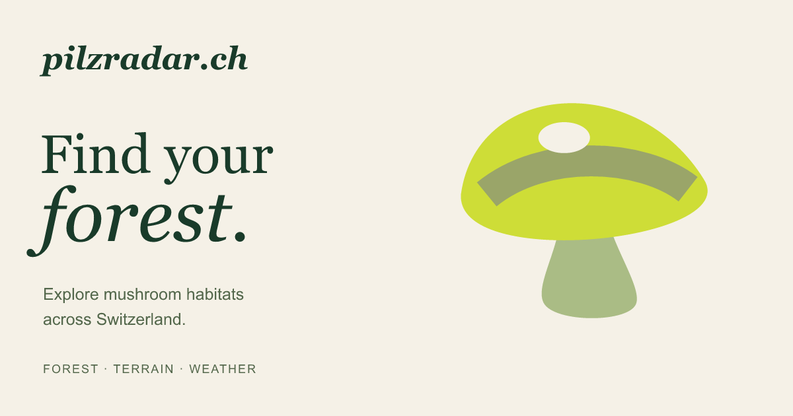

# pilzradar.ch

Explore mushroom habitats across Switzerland, compare species and keep a private field notebook.

**[Open pilzradar.ch](https://www.pilzradar.ch/)** · [Report an issue](https://github.com/andrinr/pilzradar/issues) · [Contribute](CONTRIBUTING.md)

[](LICENSE)


*Earlier Zürich interface, September 2026. Basemap: GIS-ZH and © [OpenStreetMap contributors](https://www.openstreetmap.org/copyright).*

## What it does

- One Swiss map with lightweight overviews and 50 m local detail loaded as you zoom.
- 22 mushroom profiles: 20 experimental habitat models and two observation-only entries.
- A combined default heatmap averaging the 20 modelled species, with individual species maps and visible score contributions.
- Saved places, sightings and notes stored in your browser, with JSON export/import.
- German, French, Italian, Romansh and English.

Scores are **unvalidated habitat estimates**, not sightings or encounter probabilities. Data precision varies, and protected-area coverage is incomplete. Check local collecting rules and have mushrooms identified before eating them.

Saved places have no account or cloud backup: clearing site data removes them. [Privacy and aggregate analytics](https://www.pilzradar.ch/privacy.html).

## Run locally

Requires Node.js 24+ and Python 3 for the static preview.

```sh
npm ci
npm run build:static
python3 -m http.server 3000 --directory _site
```

Open [localhost:3000](http://localhost:3000). To deploy, publish only `_site/` to a static host. The live site uses [S3 and CloudFront](docs/aws-static.md); no application server is required.

## Contribute

[Suggest a mushroom](https://github.com/andrinr/pilzradar/issues/new?template=species.yml) or [propose an indicator](https://github.com/andrinr/pilzradar/issues/new?template=indicator.yml), including ecological sources and known data gaps. For code changes, see [CONTRIBUTING.md](CONTRIBUTING.md).

Run `npm run check` and `npm test` before submitting a pull request.

## Further reading

[Model and data limits](docs/model-and-data.md) · [Data preparation](docs/development.md) · [Mobile performance](docs/mobile-loading.md) · [Environmental datasets](docs/environment-data.md) · [Research](docs/research/predictors-and-data.md)

## License

Original code, documentation and artwork: [MIT](LICENSE). External datasets and libraries retain their own licenses; see [third-party notices](THIRD_PARTY_NOTICES.md).
