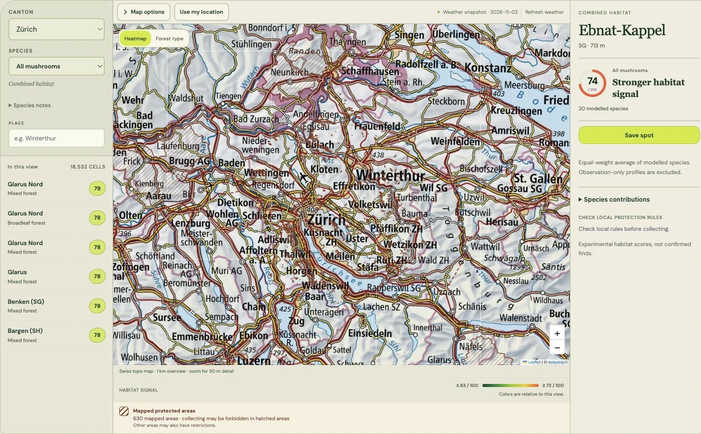

# pilzradar.ch

Explore mushroom habitats across Switzerland, compare species and keep a private field notebook.

**[Open the map](https://www.pilzradar.ch/)** · [Report an issue](https://github.com/andrinr/pilzradar/issues) · [Contribute](CONTRIBUTING.md)



[Full-resolution still](docs/media/showcase.png). Basemap © [swisstopo](https://www.swisstopo.admin.ch/).

## Features

- A combined heatmap and 20 species-specific habitat models, plus two observation-only profiles.
- Fast overviews, forest boundaries and local scoring cells down to 50 m; source precision varies.
- Forest, terrain, soil and weather indicators with a visible score breakdown.
- Saved places, sightings and notes stored locally, with JSON export/import.
- German, French, Italian, Romansh and English.

Scores are **experimental habitat estimates**, not sightings, encounter probabilities or identification advice. Protection coverage is incomplete: check local collecting rules. Clearing browser site data removes saved places; export them for backup.

## Run locally

Requires Node.js 24+ and Python 3.

```sh
npm ci
npm run build:static
python3 -m http.server 3000 --directory _site
```

Open [localhost:3000](http://localhost:3000). Deploy only `_site/` to a static host; no application server is needed. The live site uses [S3 and CloudFront](docs/aws-static.md).

## Development

Run `npm run check` and `npm test` before submitting changes. See [CONTRIBUTING.md](CONTRIBUTING.md) to add species, translations or evidence-backed indicators.

[Model and limitations](docs/model-and-data.md) · [Data preparation](docs/development.md) · [Performance](docs/mobile-loading.md) · [Environmental data](docs/environment-data.md) · [Privacy](https://www.pilzradar.ch/privacy.html)

Code, documentation and original artwork: [MIT](LICENSE). External data and libraries retain their own licenses; see [third-party notices](THIRD_PARTY_NOTICES.md).
